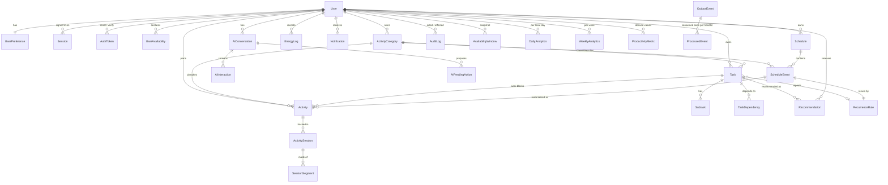

# TIMEFLOW — Database Design

PostgreSQL 17 through Prisma 6. 28 models, 47 indexes (including hand-written partial indexes), one migration (`prisma/migrations/*_init`), which also carries the constraints Prisma cannot express.

## 1. Entity-relationship diagram



`OutboxEvent` and `ProcessedEvent` carry a `userId`/`eventId` but deliberately **no foreign key** to `User`: events must outlive a deleted account long enough to be relayed, and the seed/test cleanup removes them explicitly.

## 2. Model groups

| Group | Models | Notes |
|---|---|---|
| Identity | `User`, `Session`, `AuthToken`, `UserPreference`, `UserAvailability` | Sessions store only the SHA-256 of the cookie token. `AuthToken` (reset/verify) likewise stores only a hash, single use, with expiry. |
| Plan | `ActivityCategory`, `Activity`, `Schedule`, `ScheduleEvent`, `RecurrenceRule` | `Activity` separates **plan** (`plannedStart/End`, `estimatedDurationSec`) from **reality** (`actualDurationSec`). |
| Tracking | `ActivitySession`, `SessionSegment`, `EnergyLog` | A session is one or more segments; pausing closes one, resuming opens another. |
| Tasks | `Task`, `Subtask`, `TaskDependency` | Dependencies form a DAG; cycles are rejected by the service. |
| Intelligence | `AvailabilityWindow`, `Recommendation`, `ProductivityMetric`, `DailyAnalytics`, `WeeklyAnalytics` | Derived data. Never the source of truth (ADR-0005). |
| Messaging | `Notification` | `(userId, dedupeKey)` unique → retried jobs cannot duplicate. |
| AI | `AIConversation`, `AIInteraction`, `AIPendingAction` | Token counts, estimated cost, `isDemo`, tool-call log, and proposals awaiting human confirmation. |
| Platform | `AuditLog`, `OutboxEvent`, `ProcessedEvent` | Append-only audit; transactional outbox; consumer idempotency. |

## 3. Time representation

| Concept | Column type | Example |
|---|---|---|
| An instant | `timestamptz(3)` (UTC) | `Activity.plannedStart`, `SessionSegment.startedAt` |
| A local calendar day | `date` | `DailyAnalytics.date`, `Task.occurrenceDate`, `RecurrenceRule.startDate` |
| A wall-clock time inside a day | `smallint` minutes from local midnight | `ScheduleEvent.startMinute`, `UserPreference.dayStartMinute` |
| A duration | `integer` seconds (or `smallint` minutes) | `actualDurationSec`, `bufferMinutes` |
| The interpretation zone | `varchar(64)` IANA id | `UserPreference.timezone` |

No float/decimal is used for any duration. Local-day boundaries are computed in application code with the user's zone, so DST days (23/25 h) are handled where the zone rules live.

## 4. Integrity rules enforced by the database

Beyond foreign keys and Prisma-generated unique indexes, the migration adds:

| Rule | Mechanism |
|---|---|
| **One active timer per user** | `UNIQUE (userId) WHERE status IN ('RUNNING','PAUSED')` on `ActivitySession` |
| **One open segment per session** | `UNIQUE (sessionId) WHERE endedAt IS NULL` on `SessionSegment` |
| A plan is complete or absent | `CHECK` both-or-neither of `plannedStart/plannedEnd`, and `plannedEnd > plannedStart` |
| Durations are sane | `CHECK actualDurationSec >= 0`, `estimatedDurationSec > 0`, task estimate `> 0`, complexity `1..5` |
| Segment/session ranges | `CHECK endedAt >= startedAt` |
| No self-dependency | `CHECK taskId <> dependsOnId` |
| Availability/preference ranges | `CHECK` weekday 1–7, `endMinute > startMinute`, day bounds, `weekStartsOn` 1–7 |
| Recurring event shape | `CHECK startMinute 0–1439`, `durationMin 1–1440` |
| Occurrence idempotency | `UNIQUE (scheduleEventId, occurrenceDate)` on `Activity`; `UNIQUE (seriesId, occurrenceDate)` on `Task` |
| Cheap outbox scans | partial index on `OutboxEvent(createdAt) WHERE publishedAt IS NULL` |

Application services re-check these and return friendly error codes; the constraints are the backstop that holds under concurrency.

## 5. Referential behaviour

* **User deletion cascades** to everything the user owns (the demo reset and the test harness rely on this).
* `Activity.category` is `RESTRICT` — a category with history cannot be deleted.
* `Activity.task` and `Activity.scheduleEvent` are `SET NULL` — history survives deleting the task or the recurring series.
* `AuditLog.userId` is `SET NULL` — the audit trail outlives an account.

## 6. Soft deletion — only where justified

`Activity.deletedAt` and `Task.deletedAt`. Removing a block from the *plan* must not erase what was *tracked* on it, or analytics and the audit trail would silently change. Everything else is hard-deleted; time entries are hard-deleted too, but their full content is first written to the append-only `AuditLog`.

## 7. Audit history

`AuditLog` (`actor` = `user` | `system` | `ai-coach`, `action`, `entityType/Id`, `before`, `after`, `metadata`) records: registration/login/failed login/logout/password events, session revocation, time-entry manual creation, **correction** (before/after + reason), **deletion** (full prior content), auto-stop; task create/update/complete/reopen/delete/schedule; activity deletion; every AI tool call and message; AI proposal confirmation/rejection. `GET /time-tracking/sessions/:id/corrections` and `GET /tasks/:id/history` expose the relevant slices to their owners.

## 8. Index strategy

Indexes follow the queries the screens actually issue:

| Query | Index |
|---|---|
| Activities in a time range for a user | `Activity(userId, plannedStart, plannedEnd)` |
| Tracked segments overlapping a range | `SessionSegment(userId, startedAt, endedAt)` |
| History pages | `ActivitySession(userId, startedAt)`, `(activityId, startedAt)` |
| Task lists by status/deadline | `Task(userId, status, deadline)` |
| Listing excluding deleted | `Activity/Task(userId, deletedAt, createdAt)` |
| Unread notifications | `Notification(userId, readAt, createdAt)` |
| Energy forecast | `EnergyLog(userId, recordedAt)` |
| Daily/weekly read models | `DailyAnalytics(userId, date)`, `WeeklyAnalytics(userId, weekStart)` (unique) |
| Session lookup on every request | `Session(tokenHash)` (unique) |

## 9. Query patterns

* **No N+1.** `DayContextService.loadDays` loads categories, availability rules, planned activities, segments, recurring events and the active timer for *any number of days* with a fixed number of queries, then slices per day in memory. A 90-day analytics summary issues the same handful of queries as a 1-day one.
* **Aggregation.** Totals are computed from loaded rows by the pure `computeDayMetrics`; `ActivitySession.durationSec` is a maintained total so history pages can `SUM` in the database.
* **Pagination everywhere** on lists (`skip/take` with a count), capped at 200.

## 10. Migration workflow

```bash
cd backend
pnpm prisma:migrate        # create + apply a migration in development
pnpm prisma:deploy         # apply pending migrations (CI, containers, production)
pnpm db:seed:reset         # rebuild the demo account only
```

Hand-written SQL (partial indexes, `CHECK`s) lives in the same migration file as the generated DDL so the whole history is replayable with one command.
