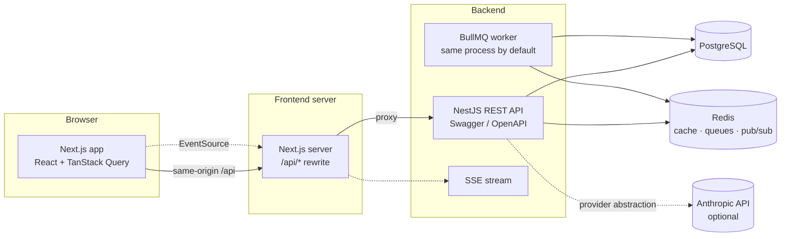
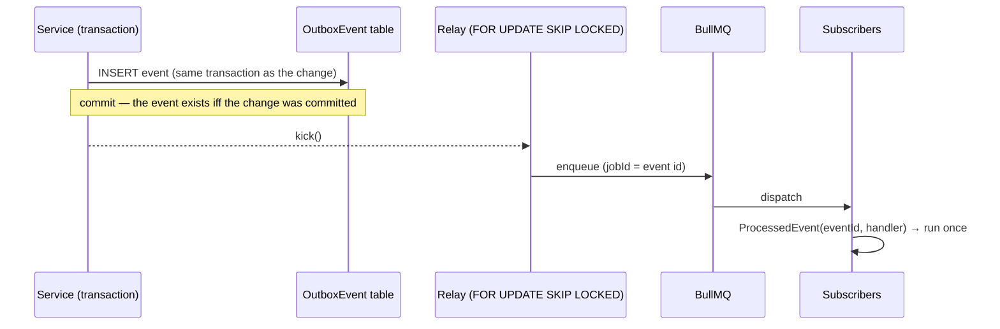

# TIMEFLOW — Architecture

## 1. System overview



* **Two applications, one contract.** The frontend and backend have separate `package.json`, TypeScript configs, builds, tests and Docker images. They share nothing but the REST API; frontend types are generated from `backend/docs/openapi.json`. CI fails if the committed contract or generated types drift.
* **Same-origin API.** The browser calls `/api/*` on the frontend origin; the Next.js server forwards to the backend (`API_INTERNAL_URL`). The `HttpOnly` session cookie is therefore first-party — no CORS preflights, `SameSite=Lax` works, and the cookie is never visible to JavaScript. CORS is still restricted (`FRONTEND_ORIGIN`) for direct callers.
* **Redis is optional in development.** Without `REDIS_URL` the cache is in-process and background jobs run inline with the same retry semantics, so the whole system works with Postgres alone. Production uses BullMQ.

## 2. Backend structure

```
backend/src
├── common/             time helpers, interval algebra, HTTP errors, decorators
├── config/             validated environment (zod); refuses to start when invalid
├── infrastructure/     Prisma, Redis, cache, queue, outbox, realtime, audit
└── modules/
    ├── auth/           sessions, Argon2id, CSRF, password reset, devices
    ├── users/          profile, preferences, weekly availability, categories
    ├── activities/     plan CRUD, reschedule, duplicate, status
    ├── time-tracking/  timer engine, manual entries, corrections
    ├── availability/   interval engine, recurrence expansion, day context
    ├── tasks/          tasks, subtasks, dependency graph, recurring generation
    ├── scheduling/     energy forecast, day planner, recurring commitments
    ├── recommendations/ explainable scoring engine
    ├── productivity/   day metrics, leakage detection, pattern/prediction engine
    ├── analytics/      dashboard, summaries, weekly/monthly reports
    ├── notifications/  in-app notifications, reminders, SSE endpoint
    ├── ai-coach/       provider abstraction, authorized tools, confirmations
    └── health/         liveness / readiness
```

Each feature module follows the same layering:

| Layer | Contents | Rule |
|---|---|---|
| Presentation | `*.controller.ts`, `*.dto.ts` | Validation + OpenAPI only; no logic |
| Application | `*.service.ts` | Transactions, authorization by session user, orchestration |
| Domain | `domain/*.ts` | **Pure functions** — no I/O, no clock, no randomness |
| Infrastructure | `infrastructure/*` | Prisma, Redis, queues |

The engines that decide things — availability, recommendations, planning, metrics, leakage, patterns, recurrence, timer rules — are pure domain functions with exhaustive unit tests. Services load data, call them, and persist results.

## 3. Time handling (the rules everything relies on)

1. **Instants are UTC.** Every timestamp is `timestamptz(3)`; the API uses ISO-8601.
2. **Days are local.** A "day" is a half-open instant range `[00:00 local, next 00:00 local)` computed in the user's IANA timezone (`UserPreference.timezone`). It is 23 or 25 hours on daylight-saving days; nothing assumes 24 hours.
3. **Local calendar dates** (`YYYY-MM-DD`) are stored as `DATE` and always interpreted with the user's zone.
4. **Recurring events are wall-clock.** A 09:00 stand-up stays at 09:00 local across DST changes; its duration is real elapsed time. Non-existent local times (spring-forward gap) move to the first valid instant after the gap; ambiguous times (fall-back overlap) resolve to the earlier occurrence.
5. **Durations are integers** (seconds or minutes). No floating-point duration arithmetic anywhere in storage or accounting.
6. **Intervals are half-open** `[start, end)`, so back-to-back items never "overlap".

## 4. Availability — separating *free* from *unknown*

The availability engine is a pure function of resolved instants (see `backend/docs/AVAILABILITY_ALGORITHM.md`). It deliberately answers three different questions separately:

| Question | Output |
|---|---|
| When am I free in the future? | `windows[]`, each with a confidence score and the reasons it is below 100 |
| What do we actually know about the past? | `TRACKED` / `PLANNED_UNTRACKED` / `UNKNOWN` |
| Is my plan consistent? | `conflicts[]` (HARD = both fixed, SOFT otherwise) |

Past time with no plan and no tracking is `UNKNOWN`. It is never added to free time.

## 5. Timer engine

* Elapsed time is **derived from persisted segment timestamps**, never from counting ticks. The browser only adds its own monotonic time since the last server answer, and re-anchors every minute and on focus — so a refresh, a closed tab or a second device always shows the correct figure.
* A session is made of segments (pause closes one, resume opens another).
* **Concurrency.** Every timer command takes a row lock on the user (`SELECT … FOR UPDATE`) inside its transaction, serialising simultaneous commands. A partial unique index (one active session per user, one open segment per session) is the database-level backstop. Starting a different activity atomically stops the previous one. An optional `expectedVersion` detects stale tabs (`409 TIMER_STATE_CHANGED`).
* Corrections and deletions never lose data: the previous values go to the append-only `AuditLog`.
* Forgotten timers: a delayed job warns after 3 h and auto-stops after 12 h (marked `autoStopped`, with a notification asking the user to correct it).

## 6. Events, jobs and real-time



* **Transactional outbox:** events are written in the same transaction as the state change, relayed at-least-once, and de-duplicated per `(event, handler)` so retries are idempotent.
* **Subscribers:** availability snapshot refresh, analytics snapshot refresh, reminder scheduling, recurring-task generation, task status, and a realtime bridge.
* **Realtime:** the bridge publishes tiny *"something changed"* hints (Server-Sent Events, Redis pub/sub across instances). Payloads carry no data; clients refetch through the normal authenticated API, so a missed hint is harmless.
* **Scheduled jobs:** activity and deadline reminders (idempotent notification keys), forgotten-timer checks, an hourly sweep that builds weekly reports at each user's local week start.

## 7. Caching and read models

* Analytics, patterns, leakage and history are cached per user under a **data version**; every write bumps the version, making all cached entries for that user unreachable at once (no key scans). Concurrent identical requests are single-flight.
* **Reads are always computed from source data** (ADR-0005). Stored daily snapshots are a background materialisation, written monotonically by compute-start time so a slow handler can never overwrite a newer one. Correctness never depends on them.

## 8. Intelligence

* **Recommendations** — transparent weighted scoring; every factor, its weight and its note is returned, and the reasons are generated from the same numbers (`backend/docs/RECOMMENDATION_ENGINE.md`).
* **Energy** — hour-by-hour expectation from the user's own check-ins (triangular smoothing), a declared focus window, or *unknown*. The planner places demanding tasks where energy is expected to cover them and keeps the peak free for them.
* **Leakage** — rule-based with evidence. Only short *unplanned* gaps count as leakage.
* **Patterns & forecast** — medians, quartiles, rolling comparisons; each insight carries sample size, a sufficiency level and a confidence. Behind a `PredictionProvider` interface so a Python analytics service can replace it later.
* **AI coach** — provider abstraction (real model or deterministic demo), tool-only data access, audit log, rate and cost limits, human confirmation for changes.

## 9. Frontend structure

See `frontend/docs/FRONTEND_ARCHITECTURE.md`. In short: Next.js App Router, server components for static shells and metadata, client components for interactive screens; TanStack Query for server state, Zustand only for layout preferences; React Hook Form + Zod for forms; Recharts (code-split) for charts; a centralised API client that handles CSRF, error contracts and session expiry.

## 10. Deployment notes

* Production requires `COOKIE_SECURE=true` (the process refuses to start otherwise unless `ALLOW_INSECURE_COOKIES=true`, which exists only for the local docker demo over plain HTTP).
* The backend applies `prisma migrate deploy` on boot (idempotent).
* Behind a reverse proxy the client address is taken from `X-Forwarded-For` (`trust proxy` is enabled only in production).
* Health: `GET /api/health/live` and `/api/health/ready` (database required, Redis optional, queue counters).
* Tracing: set `OTEL_EXPORTER_OTLP_ENDPOINT`; logs are structured JSON with request ids and redacted credentials.
